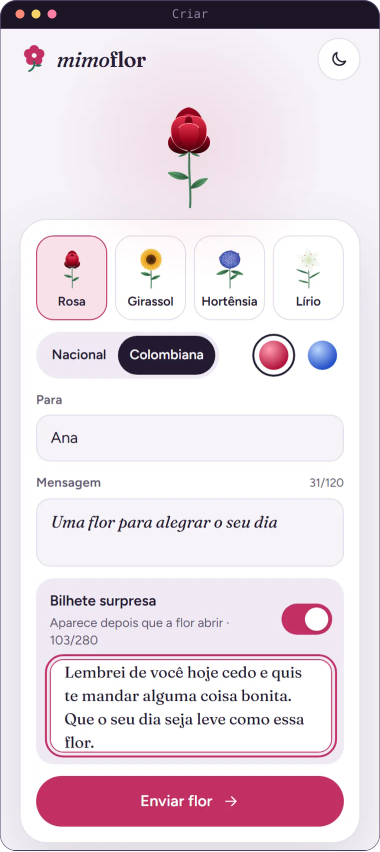
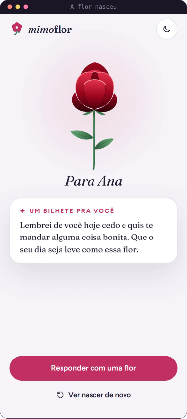
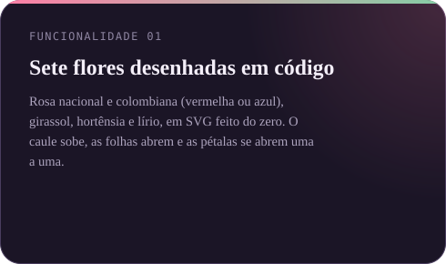
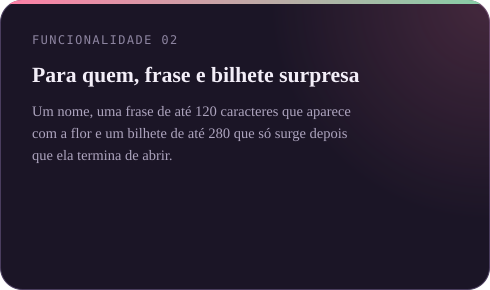
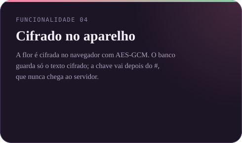
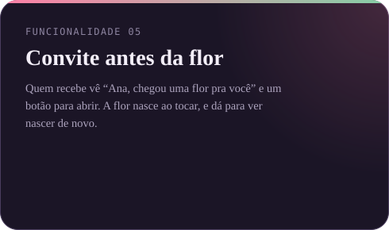
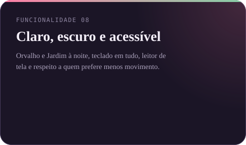
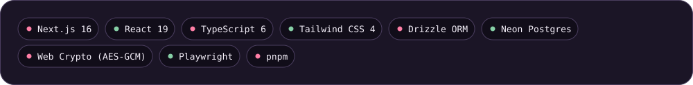

<!-- Arquivo gerado pelo readme-kit. Não edite aqui: altere docs/readme/ e rode "readme-kit build". -->
<div align="center">


<br />

<a href="https://mimoflor.vercel.app"></a>
<a href="https://github.com/diegonatalo/mimoflor"></a>

<br />


</div>

<br />

<div align="center">


</div>

**Mande uma flor que floresce na tela de alguém.**<br />
Escolha uma flor, escreva para quem é e envie um link curto. Quem abre vê a flor nascer pétala por pétala e, depois, um bilhete surpresa. Tudo é cifrado no seu aparelho: nem o servidor consegue ler as mensagens.

<br />

<div align="center">


</div>

<div align="center">

<table>
  <tr>
    <td align="center" width="33%"><br />
      <sub><b>Criar</b>: flor, para quem e bilhete surpresa.</sub></td>
    <td align="center" width="33%"><br />
      <sub><b>Convite</b>: a surpresa antes da flor.</sub></td>
    <td align="center" width="33%"><br />
      <sub><b>A flor nasceu</b>: e o bilhete chega depois.</sub></td>
  </tr>
</table>

</div>

<br />

<div align="center">


</div>

<div align="center">



<br />


<br />


<br />



</div>

<br />

<div align="center">


</div>

<div align="center">



</div>

<br />

<div align="center">


</div>

Requer [Node.js](https://nodejs.org), [pnpm](https://pnpm.io) e um Postgres (no computador, uma branch `dev` do Neon com um banco terminado em `_dev`).

```bash
git clone https://github.com/diegonatalo/mimoflor.git
cd mimoflor
pnpm install
cp .env.example .env.local   # preencha DATABASE_URL e DATABASE_URL_UNPOOLED
pnpm db:migrate              # cria as tabelas no banco do .env.local
pnpm dev                     # http://localhost:3000
```

| Comando | O que faz |
|---|---|
| `pnpm dev` | Servidor de desenvolvimento |
| `pnpm build` | Gera o build de produção (checa os tipos) |
| `pnpm start` | Serve o build de produção |
| `pnpm lint` | Roda o ESLint |
| `pnpm test` | Roda os testes (Vitest) |
| `pnpm test:e2e` | Roda os testes de ponta a ponta (Playwright) contra o build |
| `pnpm db:generate` | Gera uma migração em `drizzle/` depois de mudar `lib/db/schema.ts` |
| `pnpm db:migrate` | Aplica as migrações no banco do `.env.local` |

### 🔑 Variáveis de ambiente

Veja [`.env.example`](.env.example).

| Variável | Descrição | Se não definir |
|---|---|---|
| `DATABASE_URL` | Postgres (Neon) com pooling, usado pelo app. No computador, o nome do banco precisa terminar em `_dev`. | O app não guarda flores |
| `DATABASE_URL_UNPOOLED` | Conexão direta, usada pelas migrações. | Usa a `DATABASE_URL` |
| `RATE_LIMIT_SECRET` | Chave do HMAC que embaralha o IP na contagem de flores por hora. Uma diferente por ambiente. | Cada servidor sorteia a sua |
| `NEXT_PUBLIC_SITE_URL` | URL pública do site, para Open Graph, robots e sitemap. Sem barra no final. | Usa `https://mimoflor.vercel.app` |

### 🧪 Testes

```bash
pnpm test        # Vitest
pnpm test:e2e    # Playwright, contra o build de produção e o Postgres
```

O Vitest cobre a cifragem (abre com a chave certa, recusa chave errada e texto adulterado), a validação do presente e do que o servidor guarda, o código curto, a geometria das flores, a tela de criação (bilhete surpresa, envio só do texto cifrado) e a de quem recebe (convite, bilhete depois da flor, link sem chave).

O Playwright cria uma flor pela interface, abre o link num navegador limpo, confere que a chave nunca vai ao servidor e que o bilhete aparece depois da flor. No CI, roda contra um Postgres descartável.

Os prints da landing e deste README saem de `SCREENSHOTS=1 pnpm test:e2e e2e/screenshots.spec.ts`.

<br />

<div align="center">


</div>

```text
├── app/
│   ├── page.tsx                 "/" a landing
│   ├── app/page.tsx             "/app" criar a flor
│   ├── app/f/[id]/page.tsx      "/app/f/<código>#<chave>" quem recebe
│   ├── privacidade/, termos/    páginas legais
│   ├── not-found.tsx, error.tsx 404 e erro no visual do app
│   └── opengraph-image.tsx      prévia do link
├── components/
│   ├── flower.tsx, flower.css   monta a flor e a animação de nascer
│   ├── flowers/                 rosa, rosa colombiana, girassol, hortênsia e lírio
│   ├── creator/                 formulário, bilhete surpresa e tela de compartilhar
│   ├── received/                convite, flor e bilhete de quem recebe
│   └── landing/                 seções da landing
├── lib/
│   ├── gift.ts                  o presente e a validação dele
│   ├── gift-crypto.ts           cifra e decifra no navegador (AES-GCM)
│   ├── sealed.ts                o que o servidor aceita guardar e por quanto tempo
│   ├── flowers.ts               catálogo das flores e tempo de abrir
│   ├── flower-geometry.ts       contas dos desenhos (sementes, florzinhas, estames)
│   ├── data/actions.ts          guarda a flor cifrada e limita por hora
│   ├── data/queries.ts          lê a flor cifrada de um código
│   └── db/                      schema e conexão (Drizzle + pg)
├── drizzle/                     migrações
└── e2e/                         Playwright: fluxo completo, navegação e prints
```

<br />

<div align="center">


</div>

### 🔐 Como o link fica curto e sem spoiler

1. O navegador de quem envia monta o presente (flor, nome e bilhete) e cifra com uma chave AES-GCM nova, gerada ali mesmo.
2. Só o texto cifrado e o IV vão para o servidor, que guarda os dois no Postgres com um código aleatório de 10 letras, válido por 90 dias.
3. O link é `/app/f/<código>#<chave>`. O que vem depois do `#` nunca sai do navegador: não chega ao servidor, ao banco nem aos logs.
4. Quem recebe abre o link, o navegador busca o texto cifrado pelo código e decifra com a chave do `#`.

| Peça | Onde fica |
|---|---|
| Nome e bilhete | Só dentro do texto cifrado |
| Texto cifrado e IV | Banco (Neon, São Paulo), por 90 dias |
| Chave | Só no link, depois do `#` |
| IP de quem cria | Nunca: só um HMAC, para limitar 30 flores por hora |

### 🧩 Como adicionar uma nova flor

1. Desenhe a flor em `components/flowers/minha-flor.tsx` num quadro de 320 × 400, com o caule saindo do pé e a cabeça no terço de cima. Use `Stem`, `Leaf`, `Grow` e `Fade` de `shared.tsx`: cada peça recebe o segundo em que nasce.
2. Inclua o tipo em `FlowerKind`, o nome em `flowerName` e o tempo de abrir em `BLOOM_SECONDS` (`lib/flowers.ts`). O bilhete surpresa espera esse tempo.
3. Registre o desenho em `DRAWINGS` (`components/flower.tsx`) e, se for aparecer no seletor, em `PICKER`.

### 🌐 Deploy

Publicado na [Vercel](https://vercel.com), só a partir da `main`. O banco vem da integração Neon da Vercel. O script `vercel-build` roda `drizzle-kit migrate` antes do `next build`, então as migrações sobem junto com o deploy.

> [!IMPORTANT]
> Defina `RATE_LIMIT_SECRET` na Vercel (um valor diferente por ambiente). Sem ele, cada instância sorteia a sua chave e o limite de flores por hora passa a contar separado.

### 🧭 Próximos passos

- [ ] Mais flores (tulipa, margarida, orquídea)
- [ ] Mensagens prontas para datas especiais, como aniversários
- [ ] E-mail definitivo de privacidade (hoje é provisório)

### 📄 Créditos e licença

- Distribuído sob a licença **MIT**. Veja o arquivo [LICENSE](LICENSE).

<br />

<div align="center">


</div>

<div align="center">

<a href="https://diegonatalo.dev"></a>
<a href="https://www.linkedin.com/in/diegonatalo/"></a>
<a href="https://github.com/diegonatalo"></a>

</div>

<br />

<div align="center">


</div>
